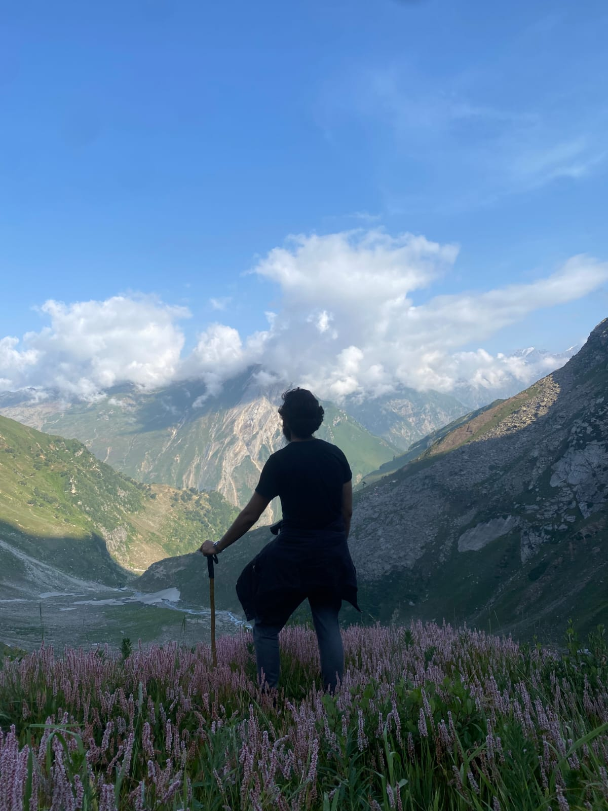

- ag2591 [at] cam [dot] ac [dot] uk
- abdullahghani2002 [at] gmail [dot] com

I am broadly interested in networked sociotechnical systems, with a focus on security and privacy. I am currently pursuing an MPhil in Advanced Computer Science at **King's College, University of Cambridge** as a Cambridge Trust Scholar, where I also serve as the Student Representative for the MPhil ACS. For my MPhil thesis at the **[Cambridge Cybercrime Centre](https://www.cambridgecybercrime.uk/)**, I am working with **[Prof. Alice Hutchings](https://www.cst.cam.ac.uk/people/ah793)** on a longitudinal study of how attackers build and share configurations for account-cracking tools on Telegram.

Before Cambridge, I graduated from the Lahore University of Management Sciences, Pakistan with a 4.00/4.00, joint-highest in my batch (1/165), advised by **[Dr. Ihsan Ayyub Qazi](https://ihsanqazi.com)** and **[Dr. Zafar Ayyub Qazi](https://www.lums.edu.pk/lums_employee/3337)**.

 Previously, I have worked extensively on building a framework to longitudinally investigate how online trackers on sensitive websites compromise user privacy (Accepted @ IMC 2026, advised by **[Dr. Zubair Shafiq](https://web.cs.ucdavis.edu/~zubair/)**), conducting an advertiser-level audit across 30 countries to evaluate global disparities in child-safety practices in children’s video advertising and building a scalable method to mitigate associated risks (under review, WWW 2027), and examining the risks and opportunities of large language models (LLMs) in multilingual, global fact-checking (Published @ Nature Scientific Reports).

I am currently seeking Ph.D. positions for Fall 2027.

## Publications

**PixelConfig: Longitudinal Measurement and Reverse-Engineering of Meta Pixel Configurations**  
<u>Abdullah Ghani</u>, Yash Vekaria, Zubair Shafiq.  
<b>ACM Internet Measurement Conference (IMC) 2026</b>.  
[Link](https://doi.org/10.1145/3777912.3809147) | [Code](After Publication) | [Tool](https://pixel-frontend-1glb.onrender.com/)

**Large Language Models Show Dunning-Kruger-like Effects in Multilingual Fact-Checking**  
Ihsan Ayyub Qazi, Zohaib Khan, <u>Abdullah Ghani</u>, Agha Ali Raza, Zafar Ayyub Qazi, Wassay Sajjad, Ayesha Ali, Asher Javaid, Muhammad Abdullah Sohail, Abdul Hameed Azeemi 
<b>Nature Scientific Reports, 2026</b>. 
[Link](https://doi.org/10.1038/s41598-026-39046-w) | [Code](https://drive.google.com/drive/u/2/folders/1ySG6PORa59TpDHTIxddMhoU7m5_sbe6N) | [Data](https://drive.google.com/drive/u/2/folders/1ySG6PORa59TpDHTIxddMhoU7m5_sbe6N)

**Advertisers, Provenance, and Safety: A 30-Country Audit of Children’s YouTube Ads**  
<u>Abdullah Ghani</u>, Yahya Khawaja, Usman Naseem, Ihsan Ayyub Qazi, Zafar Ayyub Qazi.  
*Under Review, WWW 2027*.  

**Whose Norms? Cultural Context in LLM Moderation of Children’s Ads on YouTube**  
Abubakar Mughal, <u>Abdullah Ghani</u>, Zafar Ayyub Qazi.  
*Under Review, WWW 2027*.  

## Other Research Projects

In addition to the aforementioned projects, I have also contributed to the following projects:

*   **Embedding The Truth: Approximate Caching for Fact Checking**  
    *Course Project for CS6303: Topics in Large Language Models.* Explored the feasibility of reusing fact-checking claims across organizations to improve efficiency. Used an approximate caching approach with multilingual embeddings in a vector database to identify recurring claims. [[PDF]](/files/embeddingthetruth.pdf)

*   **Decoding User Concerns in AI Health Chatbots**  
    *Course Project for CS682: Topics in Computer and Network Security.* Collected and analyzed over 50,000+ user reviews from health chatbot apps using BART and Gemini to assess their effectiveness compared to manual analysis and to qualitatively examine user concerns related to data misuse, transparency, and consent.
    [[arXiv Link](https://arxiv.org/abs/2502.00067)] | [[Got Cited by Google!](https://arxiv.org/pdf/2508.19932)]

### Current & Ongoing Research
I am currently working on the following problems:
*   **Telegram-Facilitated Credential Stuffing (MPhil Thesis):** Studying, over time, how attackers build and share configuration files for account-cracking tools on stolen-data Telegram channels, including the tools' evasion capabilities, the sectors they target, and the role of AI, to inform platform defenses and policy.
*   **Improving Human-AI Interaction in Medical Chatbots:** Running a preregistered randomized controlled trial to test whether a chatbot that asks clarifying questions and structures its answers helps laypeople assess medical conditions and decide on care. *Manuscript writing nearly complete.*
*   **LLMs as Simulated Survey Participants:** Investigating whether LLMs can stand in for human participants in misinformation research, replicating a U.S. study and an original survey of Pakistani partisans to examine the reasoning behaviors and regional biases they manifest. *Manuscript writing nearly complete.*

## Development & Software Projects
Beyond my formal research, I enjoy building software that solves interesting technical challenges and deepens my understanding of core computer science principles.

*   **Distributed, Fault-Tolerant Key-Value Store**  
    *(Go)*: Engineered a distributed data store from scratch, implementing the Raft consensus algorithm to achieve fault tolerance through leader election and persistent log replication. [[GitHub](https://github.com/abdullahghani2002/RAFT---Distributed-Fault-Tolerant-Key-Value-Store)]

*   **Virtual UNIX File System**  
    *(C)*: Implemented a UNIX-like virtual file system with a partitioned architecture of superblocks, inodes, and data blocks to manage low-level file I/O operations. [[GitHub](https://github.com/abdullahghani2002/UNIX-File-System)]

*   **User-Level Threading Library**  
    *(C)*: Developed a lightweight threading library that enables application-level context switching by directly managing CPU registers and process control blocks (PCBs). [[GitHub](https://github.com/abdullahghani2002/User-Level-Threading-Library)]

*   **Succession Planning Software**  
    *(MERN Stack, TensorFlow)*: Designed and built a full-stack application that uses a TensorFlow model to analyze performance data and identify high-potential candidates for leadership roles. [[GitHub](https://github.com/Mustafa-79/Succession-Planning)]

*   **PakStay Advisor**  
    *(Python, Scikit-learn)*: Created an end-to-end data science project that scrapes hotel data and uses predictive models to provide profitability and reliability insights for both travelers and hotel managers. [[Blog](https://medium.com/@jawad.saeed586/extracting-insights-from-booking-com-hotels-using-machine-learning-e24fcc8f15f0)]

## Teaching Experience

1. **Topics in Large Language Models: Systems and Applications** (Graduate, Fall 2025)
2. **Data Science**                                              (Fall 2024)  
3. **Data Structures**                                           (Spring 2024)  
4. **Discrete Mathematics**                                      (Fall 2023)  

Apart from solidifying my own understanding of these subjects in unanticipated ways, taking on the role of a teaching assistant has allowed me to:
- Mentor research and data science projects for 50+ graduate and undergraduate students.  
- Creatively design programming assignments (e.g., AVL Trees in C++, Causal Inference in Python, RAG and multi-agent workflows).  
- Structure comprehensive exams and quizzes.  
- Deliver live tutorials and hold office hours for classes of 100-150+ students.  
- Use code-similarity checkers (e.g., JPlag) to maintain academic integrity.  

## Awards and Honours

- **Cambridge Trust Scholarship (Vicky Noon)**: Awarded to one Pakistani student per year, across all majors and degrees, to attend the University of Cambridge.  
- **ACM IMC 2026 Travel Grant**: Received a travel grant of $1500 to attend and present PixelConfig at ACM IMC 2026 in Karlsruhe, Germany.  
- **Full Merit Scholarship Award**: Awarded annually to one of the top 3 students in the LUMS SBASSE program (260+ students) for three consecutive academic years (2022-2025).  
- **Graduated with High Distinction; Dean’s Honour List**: Consecutively awarded from 2021-2025 academic years.  
- **Top Candidate at School (A Levels)**: Achieved the highest grades at Lahore Grammar School Defence.  
- **Top 20 National Mathematics Talent Contest**: Shortlisted from candidates across Pakistan to represent Pakistan at the International Mathematics Olympiad.
- **Academic Excellence**: Scored an A+ in over 70% of my graded courses.

## Miscellaneous

- A very helpful [resource](https://www.cs.cmu.edu/~harchol/gradschooltalk.pdf) for graduate school applications that greatly aided me in my journey.  
- Some [golden advice](https://ihsan-qazi.blogspot.com/2010/08/few-pieces-of-advice-i-gave-to-my.html) from my mentor, Dr. Ihsan, that I strive to follow in my academic and personal growth.
- I wish I could find the time to swim everyday, it does wonders.
- When I'm not working, I love exploring and spending time alone with nature. Here is a photo from a recent, arduous trek I made to Chitta Katha Lake in the Himalayas!

    
    
<em>Enroute to Chitta Katha Lake, Shounter Valley.</em>

